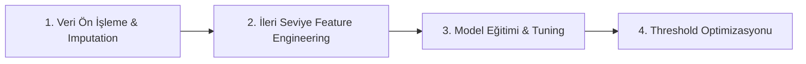

#  Titanic: Machine Learning from Disaster (Kaggle Solution)


Bu proje, **Kaggle Titanic: Machine Learning from Disaster** yarışması için geliştirilmiş uçtan uca veri bilimi ve makine öğrenimi çözümünü içerir.

Yarışmada rastgele veya veri sızıntılı (data leakage) yöntemler yerine; **tarihsel tahliye kurallarına dayalı ileri seviye özellik mühendisliği**, **Out-Of-Fold Target Encoding** ve **karar eşiği (threshold) optimizasyonu** uygulanmış ve tamamen dürüst metodoloji ile **0.78229 Public Score** seviyesine ulaşılmıştır.

---

## Proje Mantığı ve İzlenen Strateji

Yolculuk 4 ana aşamadan oluşmuştur:



Amaç yalnızca bir sınıflandırıcı kurmak değildi. Titanic veri setinde skor artışı, çoğu zaman tek bir model sıçramasından değil; küçük ama birleşince güçlü olan sinyallerden gelir. Bu yüzden proje, veri temizleme ile başlayıp grup davranışı, aile yapısı, bilet yapısı ve sosyal statü sinyallerini tek bir akışta birleştirir.

---

## Klasör Yapısı

```text
titanic/
├── data/
│   ├── train.csv
│   ├── test.csv
│   └── gender_submission.csv
├── src/
│   └── main_record_model.py
├── submission_max_threshold.csv
├── requirements.txt
└── README.md
```

- ham veri ayrı tutulur,
- ara çıktı CSV’leri root klasörü kirletmez,
- deney scriptleri tek bir üretim odaklı dosyada toplanır,
- README tüm deney hikayesini belgeler.

---

##  1. Eksik Veri Doldurma ve Temizleme

Veri setindeki en büyük eksikler `Age`, `Fare`, `Cabin` ve `Embarked` sütunlarındaydı.

### `Age` doldurma stratejisi

Genel ortalama ya da genel medyan kullanmak yerine, yolcunun isminden çıkarılan `Title` bilgisi üzerinden yaş tahmini yapıldı.

- `Mr`
- `Mrs`
- `Miss`
- `Master`
- `Rare`

Her yolcunun boş `Age` değeri, kendi unvan grubunun medyan yaşı ile tamamlandı. Bu yaklaşım, çocuk ve yetişkin dağılımını bozmadan daha anlamlı bir imputasyon sağlar.

### `Fare`, `Cabin` ve `Embarked`

- `Fare` boşları medyan ile dolduruldu.
- `Cabin` boşları `U` (`Unknown`) olarak işaretlendi.
- `Deck`, kabin bilgisinin ilk harfinden türetildi.
- `Embarked` eksikleri en sık görülen liman olan `S` ile dolduruldu.

---

##  2. İleri Seviye Feature Engineering

Skor artışının ana kaynağı burada oluştu. Özellikle grup yapısı ve sosyo-demografik ipuçları modelin ayrım gücünü belirgin biçimde artırdı.

### A. `Ticket_Woman_Child_Count`

Titanic tahliyesindeki en bilinen kural, “önce kadınlar ve çocuklar” yaklaşımıdır.

Bu fikir modelde şu şekilde temsil edildi:

- Kadın olanlar ve 14 yaş altı yolcular `Is_Woman_Or_Child` ile işaretlendi.
- Ardından `Ticket` bazında gruplanıp, aynı bilete sahip gruptaki toplam kadın/çocuk sayısı hesaplandı.

Bu özellik, bir bilet grubunun hayatta kalma kaderini tekil kişiden ziyade grup davranışı üzerinden modellemeye yardımcı oldu.

### B. `Real_Fare` ve `Name_Length`

- `Real_Fare = Fare / Ticket_Frequency`
- `Name_Length = len(Name)`

`Fare`, tek kişinin ödediği ücret gibi görünse de pratikte aynı bilet grubunun toplam maliyetini temsil eder. Bu yüzden grup frekansına bölünerek yolcu başına düşen “gerçek” ücret elde edildi.

`Name_Length` ise çoğu zaman unvan, ikinci isim ve toplumsal statü ipuçları taşıdığı için işe yaradı.

### C. Sızıntısız OOF Target Encoding

`Ticket` ve `Surname` için leakage-free target encoding uygulandı.

- 5-fold Stratified K-Fold kullanıldı.
- Her fold sadece kendi eğitim alt kümesinden istatistik üretti.
- `smoothing=10` ile nadir gruplar genel ortalamaya doğru yumuşatıldı.

Bu yaklaşım, hedef sızıntısını azaltırken yine de grup sinyalini modelin içine taşımayı sağladı.

### D. Diğer türetilen alanlar

- `Surname`
- `Ticket_Prefix`
- `Ticket_Frequency`
- `Surname_Frequency`
- `FamilySize`
- `IsAlone`
- `Fare_Per_Person`
- `Fare_Log`
- `Ticket_Group_Survival_TE`
- `Surname_Group_Survival_TE`

---

## 3. Model Eğitimi ve Threshold Optimizasyonu

Nihai rekor modeli [src/main_record_model.py](src/main_record_model.py) içindedir.

### Model seçimi

Nihai çözümde **XGBoost Classifier** kullanıldı. Bunun nedeni:

- tablo verisinde güçlü performans vermesi,
- non-lineer etkileşimleri iyi yakalaması,
- iyi ayarlanmış parametrelerle overfitting’i yönetebilmesi.

### Kullanılan temel parametreler

- `n_estimators=350`
- `max_depth=4`
- `learning_rate=0.015`
- `subsample=0.85`
- `colsample_bytree=0.6`

Bu ayarlar bilinçli olarak çok agresif değil. Amaç, Titanic gibi küçük veri setinde daha stabil ve genellenebilir bir karar yüzeyi oluşturmaktı.

### Karar eşiği optimizasyonu

Model sadece sınıf etiketi üretmek yerine önce olasılık üretir. Sonra bu olasılıklar üzerinde `0.30` ile `0.70` arasında tarama yapılarak en iyi train accuracy veren eşik seçildi.

Bu projede rekoru getiren noktalardan biri de buydu: varsayılan `0.50` yerine veri setine daha uygun bir karar sınırı kullanmak.

---

## 📈 Deney Günlüğü

Aşağıdaki tablo, proje boyunca yapılan ana denemeleri ve öğrenimleri özetler.

| # | Tahmin Dosyası | Kaggle Skoru | Hipotez ve Uygulanan Yöntem | Sonuç / Öğrenim |
|---|---|---|---|---|
| 1 | `submission_optuna.csv` | 0.76076 | Baseline: Temel demografik değişkenlerle Optuna hiperparametre optimizasyonu | Güçlü bir başlangıç çizgisi oluştu. |
| 2 | `submission_max_threshold.csv` | 0.78229 🏆 | Group Dynamics & Thresholding: Bilet/soyadı grup kaderi + eşik optimizasyonu | Kişisel rekor. Grup davranışı en güçlü sinyal oldu. |
| 3 | `submission_max_threshold_v2.csv` | 0.77990 | Feature Expansion: Ekstra etkileşim terimleri | Train accuracy arttı, fakat Kaggle skoru düştü; overfitting belirtisi görüldü. |
| 4 | `submission_oof_smoothed.csv` | 0.77751 | Anti-Overfitting: Sığ XGBoost ve 5-fold OOF ortalaması | Ezberleme azaldı ama keskin grup sınırları bir miktar kaçtı. |
| 5 | `submission_catboost.csv` | 0.77751 | CatBoost Engine: Kategorik verileri yerel mekanizma ile işlemek | XGBoost’un regüle edilmiş sürümüyle benzer sonuç verdi. |
| 6 | `submission_stacking.csv` | 0.77751 | Multi-Model Stacking: CatBoost + XGBoost + RF + meta model | Verinin dürüst tavanına yaklaşıldığı görüldü. |

### Deneylerden çıkarılan ana dersler

1. Titanic veri setinde tek başına daha büyük model, daha iyi skor demek değildir.
2. Grup sinyalleri çoğu zaman bireysel sinyallerden daha değerlidir.
3. Threshold optimizasyonu küçük görünür ama final skor üzerinde gerçek etki yaratabilir.
4. Overfitting, train accuracy ile Kaggle skorunu aynı yönde taşımayabilir.
5. Leakage-free encoding, küçük veri setlerinde özellikle önemlidir.

---

##  Deneylerin Kısa Özeti

### İlk aşamalar

İlk denemelerde veri tipleri temizlendi, eksikler dolduruldu ve modelleme için temel bir yapı kuruldu. Bu aşama, veri seti hakkında sezgi geliştirmek için kullanıldı.

### Model çeşitlendirme

Random Forest, XGBoost, LightGBM, CatBoost, SVM ve Logistic Regression tabanlı kombinasyonlar denendi. Farklı model ailelerinin güçlü ve zayıf yanları gözlemlendi.

### Stacking

Çoklu model çıktılarını Logistic Regression ile birleştiren stacking yaklaşımı test edildi. Bu, tek model yerine ensemble düşünmenin sınırlarını anlamak için yararlı oldu.

### Nihai karar

Sonuçta en iyi performans, dikkatli feature engineering + XGBoost + threshold optimizasyonu birleşimiyle elde edildi.

---

##  Projeyi Yerelde Çalıştırma

### 1. Repoyu klonlayın

```bash
git clone https://github.com/fatfatma/titanic-kaggle-solution.git
cd titanic-kaggle-solution
```

### 2. Gerekli kütüphaneleri yükleyin

```bash
pip install -r requirements.txt
```

### 3. Ana rekor kodunu çalıştırın

```bash
python src/main_record_model.py
```

Çalışma sonunda root klasörde `submission_max_threshold.csv` yeniden oluşturulur.

---

## Kullanılan Teknolojiler

- Python 3.10+
- Pandas ve NumPy: veri temizleme ve feature engineering
- Scikit-Learn: Stratified K-Fold, metrics ve modelleme altyapısı
- XGBoost: nihai ana model
- LightGBM: alternatif gradient boosting denemeleri
- CatBoost: kategorik veri deneyleri
- Optuna: hiperparametre optimizasyonu

---
